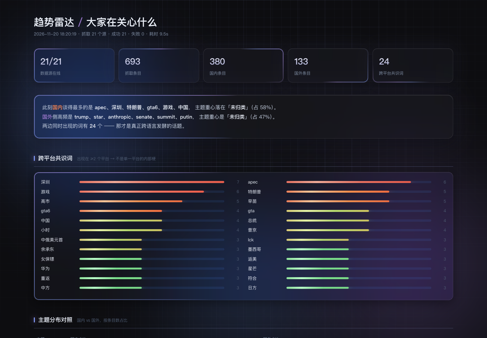

# Social Trend Radar

[中文](README.md) · English



Pulls **21 public trending feeds** (China + international + AI frontier) → normalizes → computes word frequency, topic distribution and **cross-platform consensus terms** → produces a self-contained HTML report. Optionally auto-deploys to Cloudflare Pages.

Comes with a **paper explainer**: paste an arXiv link, get a four-line breakdown (problem / method / result / limitation), and keep asking follow-ups.

```
CN:     Weibo, Douyin, Toutiao, Bilibili, Tieba, Zhihu, Douban, Baidu, Xiaohongshu
Intl:   Hacker News, Google News/Trends, NYTimes, Reddit, YouTube …
AI:     HuggingFace models/Spaces, arXiv, GitHub Trending
        free LLM APIs, free-for.dev
```

---

## ⚠️ Read this first: the experience is almost entirely about the LLM

**Fetching needs no model at all** — all 21 sources are public endpoints hit with plain `urllib`. Zero cost, zero keys.

**But there's a big gap between "runs" and "useful":**

| With an LLM | Without an LLM |
|---|---|
| English titles/summaries **auto-translated** | Raw English only |
| **One-line annotation** per item | Title only |
| Paper explainer **works** | **Completely unavailable** |
| Report is readable as-is | You translate it yourself |

**Without a key it runs, but it's just an English trending-scraper. With a key it's an actual radar.**

Any OpenAI-compatible endpoint works — OpenAI, DeepSeek, Gemini, Claude, local Ollama, vLLM:

```bash
LLM_BASE=https://api.deepseek.com/v1
LLM_KEY=sk-yours
LLM_MODEL=deepseek-chat
```

Translations are cached (`cache/translate.json`), so each headline is translated exactly once — **day-to-day cost is negligible**. The paper explainer is what actually burns tokens; put an access code on that one.

---

## Quick start

```bash
git clone <this-repo> && cd trend-radar

cp .env.example .env      # optional
python3 radar.py          # fetch one round
open out/latest.html
```

**Zero dependencies** — pure standard library, Python 3.9+.

```bash
pip install -r requirements.txt   # optional, better Chinese tokenization
```

---

## Configuration

Everything is environment variables; template in `.env.example`.

| Variable | Purpose | If unset |
|---|---|---|
| `CLOUDFLARE_API_TOKEN` | Pages deploy | local report only |
| `CLOUDFLARE_ACCOUNT_ID` | Pages account | same |
| `CF_PAGES_PROJECT` | Pages project name | `social-trend-radar` |
| `RADAR_HTTP_PROXY` | proxy for intl sources | direct |
| `PAPER_ACCESS_CODE` | paper explainer gate | no gate |
| `LLM_BASE` / `LLM_KEY` / `LLM_MODEL` | translation & paper | translation skipped |
| `YOUTUBE_API_KEY` | YouTube source | source skipped |

---

## Commands

```bash
python3 radar.py                     # one round
python3 radar.py --open              # fetch and open
python3 radar.py --with-browser      # also Xiaohongshu (needs ego-browser)
python3 radar.py --publish           # fetch and deploy
python3 radar.py --list              # list all sources
python3 radar.py --check weibo       # health-check one source
python3 radar.py --interval 600 --rounds 12
```

### Scheduled runs

macOS:

```bash
./install-daily.sh                   # 12:00 and 17:00 by default
HOURS=9,13,18,22 ./install-daily.sh  # custom times
./install-daily.sh --uninstall
```

Linux / CI — use cron or the bundled GitHub Actions workflow (`.github/workflows/daily.yml`),
which commits each round to a `gh-pages` branch. Fork the repo, add secrets, done.

---

## What's in the report

1. **One-line conclusion** — top terms per region, topic centroid, shared term count
2. **Cross-platform consensus** — terms appearing on ≥2 platforms. Single-platform terms are usually inside jokes
3. **Topic distribution** — CN vs intl share per topic
4. **Top terms** — two columns, stop-words removed, bars colored in four heat tiers (red → red-orange → orange-green → green)
5. **Raw rankings** — click through to the original site, green index = new since last round

`words.csv` is a flat table (`source,rank,title,hot,url`) ready for a pivot table.

---

## Paper explainer

```bash
PAPER_ACCESS_CODE=yourcode python3 paper_server.py   # 127.0.0.1:8833
```

Deployed to Cloudflare Pages the backend is `functions/api/*.js`. Set three env vars in the dashboard:

```
PATEWAY_KEY    your model key
PATEWAY_BASE   endpoint
MODEL          model name
```

Access control lives in `functions/api/_auth.js`:

| Method | Header | Whose quota |
|---|---|---|
| Site access code | `x-access-code: <code>` | site owner's |
| Bring your own key | `x-user-key: sk-...` | the caller's |

---

## Layout

```
radar.py            fetch → aggregate → render → publish
sources.py          15 general trending sources
sources_ai.py       AI frontier (HF / arXiv / GitHub / free APIs)
sources_browser.py  browser sources (Xiaohongshu / YouTube)
translate.py        EN→ZH + annotation, cached
paper_server.py     paper explainer, local
paper/index.html    paper explainer, frontend
functions/api/      Cloudflare Pages Functions backend
envload.py          dependency-free .env loader
.github/workflows/  daily fetch + gh-pages publish
```

---

## Known limits

- **Public endpoints only.** Login walls, CAPTCHAs and heavy anti-bot (Xiaohongshu, some YouTube) need extra machinery — see `sources_browser.py`
- **A proxy is usually required** to reach Google / NYTimes / Reddit from mainland China
- **Sources rot.** Platforms change their APIs; `sources.py` is the most fragile part
- **No long-term archive** — only the last 30 rounds are kept

## For agents: MCP server

The data isn't just readable — it's queryable.

```bash
python3 radar.py        # fetch first
python3 mcp_server.py   # start the server (stdio)
```

Configure in Claude Desktop / Cursor / any MCP client:

```json
{
  "mcpServers": {
    "trend-radar": {
      "command": "python3",
      "args": ["/absolute/path/trend-radar/mcp_server.py"]
    }
  }
}
```

**Six tools:**

| Tool | What it does |
|---|---|
| `trending_overview` | Sources online, item count, top terms per region, topic split |
| `search_term` | Where a term shows up — **returns `platform_count`; ≥2 means it's actually spreading** |
| `consensus_terms` | Cross-platform consensus ranking |
| `list_sources` | Health of every source |
| `source_items` | Full ranking for one source |
| `topic_breakdown` | CN vs intl topic share |
| `term_history` | **How long has this term been around** — trail + rising / persistent / fading / sporadic |

> **About history**: `term_history` reads `out/history.jsonl`.
> Locally it accumulates on its own; under GitHub Actions the workflow restores it from the
> `gh-pages` branch and commits it back, so it grows in CI too. Last 600 rounds kept
> (~16 MB / ~300 days).

**Why time beats the snapshot**: a single trending page can't tell "dominating for weeks"
from "just showed up today".

```
深圳  → 34/34 rounds, 4.8 platforms avg  → persistent (real trend)
小米  → 14/34 rounds                     → fading
xyz   → 1/34 rounds                     → sporadic
```

That verdict changes the decision: follow up, or ignore.

**Why this matters for agents**: a trending page is built for humans. An agent needs
structured, comparable, source-attributed data. Every term here answers: how many
platforms, what rank on each, absolute heat, original URL, and how the two regions differ.

Zero dependencies — `json`, `pathlib`, `sys`.

## Data & disclaimer

This project **only fetches publicly accessible data**, for personal research and learning.

- Content in the generated report (titles, summaries, data) **remains the copyright of the respective platforms and authors**; this project claims no rights over it
- Mind your fetch frequency and use; respect each site's `robots.txt` and terms of service
- Do not use it for commercial resale, bulk republishing, or anything that infringes authors' rights
- The code is provided under MIT, "as is", without warranty of any kind

## License

MIT © 2026 wjy1577194254-pixel
