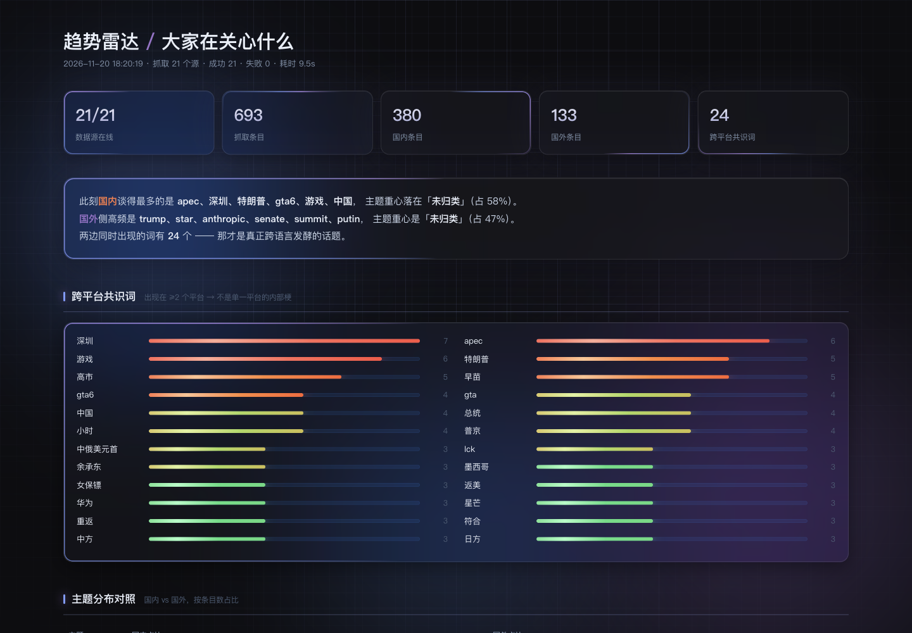
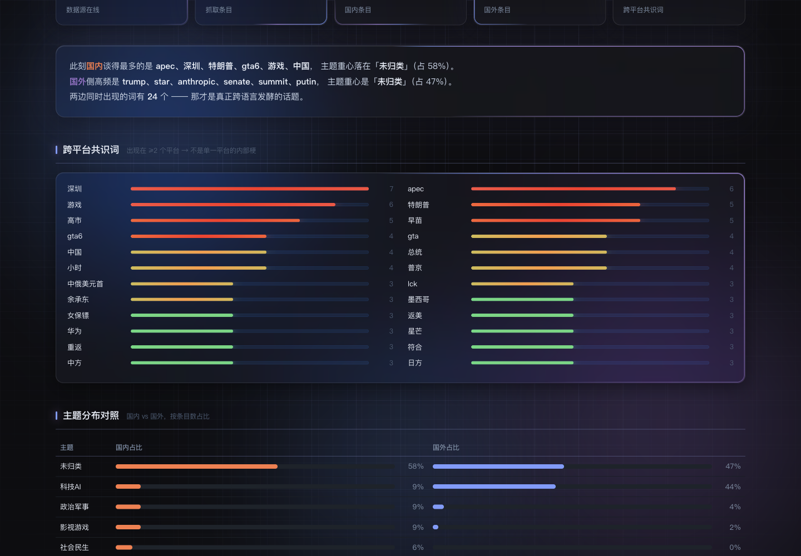

# 趋势雷达 · Social Trend Radar

[English](README.en.md) · 中文



<details>
<summary>跨平台共识词 —— 条形按热度分四档配色（红 → 红橙 → 橙绿 → 绿）</summary>



</details>

抓 21 个国内外公开热榜 → 归一化 → 词频 / 主题分布 / 跨平台共识词 → 出一份自包含 HTML 报告，可选自动发布到 Cloudflare Pages。

加一个配套的**论文讲解器**：贴一篇 arXiv 链接，出「问题 / 方法 / 结果 / 局限」四句话解读，可以继续追问。

---

## ⚠️ 先说清楚：这项目的体验好坏，几乎全看 LLM

**抓取本身不需要任何模型** —— 21 个源都是公开接口，纯 `urllib`，零成本、零 key。

**但「能用」和「好用」差在这里：**

| 配了 LLM | 不配 LLM |
|---|---|
| 英文标题/摘要**自动翻成中文** | 全是英文原文 |
| 每条带**一句话批注**（这条在讲什么） | 只有标题 |
| 论文讲解器**能用**（四段解读 + 追问） | **完全不可用** |
| 报告可以直接读，不用点进去 | 得自己翻译 |

所以：**不配 key 能跑，但只是个英文热榜爬虫；配了 key 才是「趋势雷达」。**

配哪个都行 —— OpenAI、DeepSeek、Gemini、Claude、本地 Ollama、vLLM、任何 OpenAI 兼容端点：

```bash
LLM_BASE=https://api.deepseek.com/v1
LLM_KEY=sk-你的
LLM_MODEL=deepseek-chat
```

翻译有缓存（`cache/translate.json`），同一条标题只翻一次，**日常成本极低**。
真正烧额度的是论文讲解器 —— 那个建议加访问码。

```
国内：微博 抖音 头条 B站 贴吧 知乎 豆瓣 百度 小红书
国外：HackerNews Google News NYTimes Reddit YouTube …
AI：  HuggingFace 模型/Spaces  arXiv  GitHub Trending
      免费 LLM API  free-for.dev
```

---

## 快速开始

```bash
git clone <this-repo> && cd trend-radar

# 1) 复制配置（不填也能跑，只是不发布）
cp .env.example .env

# 2) 抓一轮，出报告
python3 radar.py

# 3) 看结果
open out/latest.html
```

跑完在 `out/<时间戳>/` 得到 `report.html` / `trends.json` / `words.csv`。

**零依赖**：纯 Python 标准库，`python3` 3.9+ 就能跑。
装了 `jieba` 会自动用精确分词（没装就用内置的兜底切分）。

```bash
pip install -r requirements.txt   # 可选，只为更好的中文分词
```

---

## 配置

所有配置走环境变量，模板在 `.env.example`。

| 变量 | 作用 | 不给会怎样 |
|---|---|---|
| `CLOUDFLARE_API_TOKEN` | Pages 部署 | 只生成本地报告 |
| `CLOUDFLARE_ACCOUNT_ID` | Pages 账号 | 同上 |
| `CF_PAGES_PROJECT` | Pages 项目名 | 默认 `social-trend-radar` |
| `RADAR_HTTP_PROXY` | 抓国外源用的代理 | 直连 |
| `PAPER_ACCESS_CODE` | 论文讲解器的准入码 | 不设防 |
| `LLM_BASE` / `LLM_KEY` / `LLM_MODEL` | 翻译与论文解读 | 跳过翻译 |
| `YOUTUBE_API_KEY` | YouTube 源 | 该源跳过 |

**LLM 端点**兼容 OpenAI 协议，任意实现都行：

```bash
LLM_BASE=https://api.openai.com/v1
LLM_KEY=sk-...
LLM_MODEL=gpt-4o-mini
```

本地跑 Ollama / vLLM / LM Studio 同理，填 `http://127.0.0.1:11434/v1` 即可。

> 翻译有缓存（`cache/translate.json`），第二次刷新几乎零成本。

---

## 常用命令

```bash
python3 radar.py                     # 抓一轮
python3 radar.py --open              # 抓完直接打开
python3 radar.py --with-browser      # 额外抓小红书（需要 ego-browser）
python3 radar.py --publish           # 抓完发到 Cloudflare Pages
python3 radar.py --list              # 列出所有源
python3 radar.py --check weibo       # 单源体检
python3 radar.py --interval 600 --rounds 12   # 循环观察，第二轮起标「新上榜」
```

### 装成定时任务（macOS）

```bash
./install-daily.sh                   # 默认每天 12:00 和 17:00
HOURS=9,13,18,22 ./install-daily.sh  # 自定义时间点
./install-daily.sh --uninstall       # 卸载
```

装三个用户级 LaunchAgent（不碰系统目录）：

| Label | 作用 |
|---|---|
| `*.fetch` | 定时抓取 + 发布 |
| `*.serve` | 常驻 `127.0.0.1:8822` 提供报告 |
| `*.paper` | 常驻 `127.0.0.1:8833` 提供论文讲解器 |

日志在 `logs/`。

### Linux

用 cron 等价：

```cron
0 12,17 * * * cd /path/to/trend-radar && /usr/bin/python3 radar.py --publish >> logs/fetch.log 2>&1
```

---

## 报告里有什么

按「从结论到证据」排：

1. **一句话结论** —— 国内/国外此刻高频词 + 主题重心 + 两边共有的词数
2. **跨平台共识词** —— 出现在 ≥2 个平台的词。只在一个平台出现的多半是内部梗
3. **主题分布对照** —— 国内 vs 国外各主题占比
4. **高频词** —— 分国内、国外两列，已去停用词和冗余子串。条形按热度分四档配色（红 → 红橙 → 橙绿 → 绿）
5. **各平台原榜** —— 点标题跳原站，绿色序号 = 相比上一轮新上榜

`words.csv` 是平表（`source,rank,title,hot,url`），可以直接丢 Excel 透视。

---

## 论文讲解器

`paper_server.py` 起一个本地服务，`paper/index.html` 是前端。

```bash
PAPER_ACCESS_CODE=yourcode python3 paper_server.py   # 127.0.0.1:8833
```

贴一篇 arXiv 链接，出四段解读，可以继续追问。

**部署到 Cloudflare Pages** 时，后端是 `functions/api/*.js`（Pages Functions），
在 CF 控制台配这三个环境变量：

```
PATEWAY_KEY    你的模型 key
PATEWAY_BASE   模型端点
MODEL          模型名
```

访问控制逻辑在 `functions/api/_auth.js`，支持两种进入方式：

| 方式 | header | 走谁的额度 |
|---|---|---|
| 站点访问码 | `x-access-code: <你的码>` | 站长的 |
| 自带 Key | `x-user-key: sk-...` | 调用者自己 |

---

## 目录结构

```
radar.py            主程序：抓取 → 聚合 → 渲染 → 发布
sources.py          15 个通用热榜源
sources_ai.py       AI 前沿源（HF / arXiv / GitHub / 免费 API）
sources_browser.py  浏览器源（小红书 / YouTube，需 ego-browser）
translate.py        英译中 + 批注（带缓存）
paper_server.py     论文讲解器本地服务
paper/index.html    论文讲解器前端
functions/api/      Cloudflare Pages Functions 后端
install-daily.sh    定时任务安装脚本
vendor/jieba/       可选的中文分词
```

---

## 已知限制

- **只抓公开接口**。登录墙、验证码、反爬强度高的源（小红书、部分 YouTube）需要额外手段，`sources_browser.py` 里用的是浏览器自动化
- **代理是刚需**：国内直连抓 Google / NYTimes / Reddit 基本不通
- **热榜会变**：平台改接口就得改源，这个项目里源是最容易腐化的部分
- **不做历史归档**：只保留最近 30 轮

---

## License

MIT © 2026 wjy1577194254-pixel
